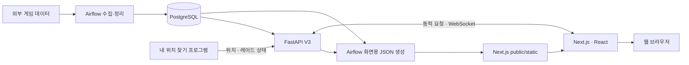

# 타르코프 도서관 · Frontend

**갱신일: 2026.10.23**

[타르코프 도서관](https://eftlibrary.com)의 웹 Frontend입니다. **Next.js App Router와 React, TypeScript**를 사용해 게임 정보와 사용자 화면을 제공하며, FastAPI API 및 WebSocket과 연동합니다.

한국어·영어·일본어를 지원하며, 모바일과 데스크톱에서 같은 컴포넌트를 반응형으로 사용합니다. 라이트·다크 모드를 함께 지원합니다.

## 전체 서비스에서 맡은 역할


게임 데이터 수집과 정기 갱신은 Airflow가, 데이터 조회·저장과 실시간 이벤트 처리는 FastAPI가 담당합니다.  
이 저장소는 화면 렌더링, Google 로그인, 사용자 상호작용, 지도 및 실시간 상태 표시를 맡습니다. PostgreSQL이나 Redis에 직접 접속하지 않습니다.



Cloudflare는 DNS Only로 사용하며, HTTPS·WSS 요청은 원본 서버의 Nginx Proxy Manager를 통해 웹과 백엔드로 연결됩니다.

## 제공하는 기능

| 영역             | 기능                                                                               | 주요 코드                                                                                                                              |
| ---------------- | ---------------------------------------------------------------------------------- | -------------------------------------------------------------------------------------------------------------------------------------- |
| 게임 정보        | 아이템·퀘스트·지도·보스·은신처·스토리·이벤트 조회                                  | `features/item`, `features/quest`, `features/map`, `features/boss`, `features/hideout`, `features/story`, `features/information-board` |
| 시세·랭킹        | PVP·PVE·시즌 PVP 가격, 가격 이력, 상인 가격, 시즌 선택과 가치 랭킹                 | `features/price`, `features/rank`                                                                                                      |
| 진행 관리        | 퀘스트 로드맵과 사용자 진행 상태                                                   | `features/roadmap`, `features/roadmap-new`                                                                                             |
| 라이브 맵        | 층·마커·목표 위치 표시, 내 위치 찾기, 지도 자동 전환, 레이드 타이머, BTR 예상 경로 | `features/live-map`                                                                                                                    |
| 파티·채팅        | 파티 모집·초대, 위치·마커 공유, 접속자·채팅, 초대 수신 설정과 관리자 제재          | `features/live-map/party`, `features/live-map/chat`                                                                                    |
| 커뮤니티·내 정보 | 게시글·댓글·반응, 프로필·북마크·알림 등 사용자 화면                                | `features/community`, `features/mypage`                                                                                                |
| 콘텐츠·운영      | 배틀패스, KORD·BREACH, 공지·패치노트·와이프, 배포 안내                             | `features/battle-pass`, `features/kord-breach`, `features/deployment-notice` 등                                                        |

내 위치 찾기 프로그램 자체는 별도 프로젝트입니다. 이 저장소는 백엔드가 전달한 위치와 레이드 상태를 받아 웹 지도에 반영합니다.

## 데이터 조회와 캐시

공개 게임 정보와 사용자별 데이터를 구분해서 처리합니다.

- **공개 게임 정보:** Airflow가 생성한 `public/static/{domain}/v3/`의 JSON과 FastAPI V3 API를 사용합니다. 공통 조회기는 [static-json-client.ts](lib/api/static-json-client.ts)에 있습니다.
- **정적 JSON 조회:** 서버에서는 `public` 아래 파일을 직접 읽고, 브라우저에서는 같은 사이트의 `/static/…` 주소로 요청합니다. 도메인별 `index.json`의 `generated_at`을 버전으로 사용합니다.
- **조회 실패 시 대체 경로:** 정적 JSON을 사용할 수 없으면 설정된 API 또는 대체 함수를 호출합니다. 개발 모드에서는 기본적으로 API를 먼저 시도합니다. 각 기능의 개별 조회 설정도 확인해야 합니다.
- **사용자별 데이터와 쓰기 요청:** 인증·진행도·저장·커뮤니티 활동은 API로 처리합니다. 실시간 상태는 WebSocket으로 갱신합니다.
- **시세:** 일반 PVP·PVE 시세와 랭킹은 약 1시간 단위의 캐시 설정을 사용합니다. 시즌 PVP 조회는 선택한 시즌의 API를 호출하며, 데이터가 없을 수 있습니다.

Airflow의 JSON 출력 경로는 `/opt/airflow/next-public`입니다. 운영에서는 생성한 파일이 이 프로젝트의 `public/static`에서 제공되도록 경로를 연결하거나 동기화해야 합니다. JSON 생성 성공, 파일 배치, 프런트엔드 캐시 갱신은 서로 다른 단계입니다.

현재 [next.config.ts](next.config.ts)는 `cacheComponents`를 활성화하고 있습니다. Next.js 16.4 업데이트에서는 기존 링크 동작을 유지하기 위해 `partialPrefetching: false`를 명시했습니다. 런타임 경로나 검색 조건 등을 읽는 컴포넌트는 필요한 위치에 `Suspense` 경계를 두어 사전 렌더링을 유지합니다.

## 로그인과 실시간 연결

Google OAuth와 NextAuth의 JWT 세션을 사용합니다. 로그인과 토큰 갱신은 [인증 라우트](app/api/auth/[...nextauth]/route.ts)에서 처리하고, 백엔드 요청에는 Google access token을 전달합니다. 일시적인 인증 서버 장애와 재로그인이 필요한 상태를 구분하며, 화면 복귀·경로 이동·토큰 만료 시점에 세션을 확인합니다.

위치·알림, 파티, 모집 채팅은 각각 별도 WebSocket을 사용합니다.

| 연결           | 경로                                        | 역할                                   |
| -------------- | ------------------------------------------- | -------------------------------------- |
| 개인 위치·알림 | `/ws?token=…`                               | 내 위치, 레이드 상태, 사용자 알림 수신 |
| 파티           | `/api/live-map/v3/party/rooms/{room_id}/ws` | 방 상태, 멤버, 마커, 위치·핑 공유      |
| 모집 채팅      | `/api/live-map/v3/chat/ws`                  | 채팅, 접속자, 초대와 관련 상태 갱신    |

개인 위치 소켓은 백엔드의 `ready` 신호를 기준으로 연결 상태를 표시하며, 재접속 시 최신 상태를 복원합니다. 레이드 타이머는 수신한 종료 시각을 기준으로 계산합니다. 지도 자동 전환은 보기 옵션에서 켜거나 끌 수 있습니다.

비로그인 채팅 연결은 백엔드에서 발급한 게스트 쿠키를 사용합니다. 교차 출처 요청에는 백엔드 CORS·쿠키 설정이 필요하며, 로컬 HTTP 웹에서 운영 HTTPS 백엔드의 게스트 쿠키를 사용하는 구성은 별도 확인이 필요합니다.

## 주요 기술

버전은 현재 [package.json](package.json)의 선언을 기준으로 하며, 설치 버전은 [pnpm-lock.yaml](pnpm-lock.yaml)에서 고정합니다.

| 기술                              | 선언 버전              | 용도                                |
| --------------------------------- | ---------------------- | ----------------------------------- |
| Next.js / React                   | `16.4.2` / `19.3.1`    | App Router, 서버 렌더링과 화면 구성 |
| TypeScript                        | `^6.0.3`               | API·컴포넌트 타입 검사              |
| Tailwind CSS / next-themes        | `^4.3.3` / `^0.4.6`    | 반응형 UI와 테마                    |
| next-auth / next-intl             | `^4.24.15` / `^4.14.9` | Google 로그인과 다국어              |
| TanStack Query / Zustand          | `^5.104.5` / `^5.0.16` | 서버 상태 캐시와 클라이언트 상태    |
| React Leaflet / React Three Fiber | `^5.0.0` / `^9.8.2`    | 2D 지도와 3D 지도                   |
| React Flow / Recharts             | `^12.12.0` / `^3.10.1` | 퀘스트 흐름과 차트                  |
| Tiptap                            | `^3.32.0`              | 게시글 편집기                       |

## 디렉토리 구조

```text
.
├── app/                    # 페이지, 레이아웃, 인증·서버 API 라우트
├── features/               # 기능별 화면, API 조회, 훅과 설정
├── components/             # 공통 UI, 레이아웃, Provider
├── hooks/                  # 공통 훅
├── lib/
│   ├── api/                # API·정적 JSON 공통 조회
│   ├── auth/               # 토큰 갱신과 세션 복구
│   ├── config/             # API 경로와 환경 설정
│   ├── seo/                # 메타데이터·검색 관련 설정
│   └── websocket/          # 위치 연결과 레이드 상태 처리
├── store/                  # Zustand 상태
├── types/                  # API·인증 등 TypeScript 타입
├── i18n/                   # 한국어·영어·일본어 설정
├── assets/                 # 소스에서 사용하는 이미지 등
├── public/                 # 정적 리소스, static JSON, robots.txt, llms.txt
├── tests/                  # 인증·세션 회귀 테스트
├── script/                 # 지도·채팅 검증과 성능 측정 도구
├── archive/                # 보관 자료
├── proxy.ts                # 요청 경로·인증 관련 처리
└── restart.sh              # 기존 운영 서버 실행·중지 스크립트
```

API 계약과 운영 문서는 별도로 관리합니다. Swagger·실제 응답을 기준으로 타입과 매핑을 작성합니다. 레거시 코드는 UI 참고용이며 기존 데이터 구조를 신규 구현에 그대로 사용하지 않습니다.

## 개발 환경과 실행

**Node.js 24와 pnpm**을 사용합니다.

```bash
nvm use 24
pnpm install --frozen-lockfile
```

루트의 `.env.local`에 환경에 맞는 값을 설정합니다. 아래 값은 로컬 개발 예시입니다.

```dotenv
NEXT_PUBLIC_API_URL=http://localhost:8000
NEXT_PUBLIC_SITE_URL=http://localhost:4000
NEXTAUTH_URL=http://localhost:4000
NEXTAUTH_SECRET=replace-with-a-random-secret
NEXT_PUBLIC_GOOGLE_ID=your-google-client-id
NEXT_PUBLIC_GOOGLE_SECRET=your-google-client-secret
```

Google OAuth에는 `http://localhost:4000/api/auth/callback/google`을 승인된 리디렉션 URI로 등록합니다. 실제 인증 정보는 커밋하지 않습니다.  
현재 코드에서 Google 비밀키 변수 이름은 `NEXT_PUBLIC_GOOGLE_SECRET`이며 서버 인증 코드에서 사용합니다. 비밀 값이므로 클라이언트 코드에서 참조하지 않습니다.

| 설정                                                                                                        | 용도                                                                                                                |
| ----------------------------------------------------------------------------------------------------------- | ------------------------------------------------------------------------------------------------------------------- |
| `NEXT_PUBLIC_API_URL`                                                                                       | FastAPI 기본 주소. 미설정 시 `http://localhost:8000`                                                                |
| `NEXT_PUBLIC_LOCAL_URL`                                                                                     | 설정하면 `NEXT_PUBLIC_API_URL`보다 우선하는 API 주소. 운영에 로컬 값이 남지 않도록 확인                             |
| `NEXT_PUBLIC_SITE_URL`                                                                                      | 사이트 대표 주소. 미설정 시 `https://eftlibrary.com`                                                                |
| `NEXTAUTH_URL`, `NEXTAUTH_SECRET`                                                                           | 인증 콜백 기준 주소와 세션 서명 비밀키                                                                              |
| `NEXT_PUBLIC_GOOGLE_ID`, `NEXT_PUBLIC_GOOGLE_SECRET`                                                        | 현재 코드에서 사용하는 Google OAuth 설정                                                                            |
| `NEXT_PUBLIC_REDIS_HOST`                                                                                    | 개인 위치·알림용 백엔드 호스트. 프로토콜·경로 없이 지정하며 코드가 `wss://{host}/ws`로 연결. Redis 서버 주소가 아님 |
| `NAVER_SITE_VERIFICATION`                                                                                   | 네이버 소유 확인 메타 태그. 서버에서 사용하며 `NEXT_PUBLIC_` 접두사가 필요 없음                                     |
| `NEXT_PUBLIC_GOOGLE_ANALYTICS`                                                                              | Google Analytics ID. 선택 설정                                                                                      |
| `NEXT_PUBLIC_ADSENSE`                                                                                       | AdSense 클라이언트 ID. 선택 설정                                                                                    |
| `NEXT_PUBLIC_ADSENSE_VERTICAL_SLOT`, `NEXT_PUBLIC_ADSENSE_HORIZONTAL_SLOT`, `NEXT_PUBLIC_ADSENSE_SIDE_SLOT` | 광고 영역별 슬롯. 선택 설정                                                                                         |
| `NEXT_PUBLIC_CHAT_API_URL`                                                                                  | 별도 `/api/chat/stream` 프록시 대상. 라이브 맵 모집 채팅과는 별개                                                   |

`NEXT_PUBLIC_` 변수는 브라우저 번들에 반영될 수 있으므로 공개 가능한 설정에만 사용해야 합니다. 변경 시에는 빌드 시점에 반영되는 값인지 확인하고 재빌드합니다.

```bash
pnpm dev
```

개발 서버는 `http://localhost:4000`에서 실행됩니다. 공개 데이터 조회에는 FastAPI 또는 생성된 JSON이 필요하고, 로그인·파티·채팅·내 위치 찾기를 확인하려면 관련 백엔드 서비스도 준비해야 합니다.

## 검증과 운영 실행

```bash
pnpm exec tsc --noEmit
pnpm lint
node --experimental-transform-types --test tests/*.test.mjs
pnpm build
PORT=4000 pnpm start
```

`pnpm start`는 `PORT`를 명시해서 실행합니다. 지도·채팅·데스크톱 연동 검증 도구는 `script/check-*.cjs`에 있으며, 브라우저 도구는 실행 중인 웹과 Playwright 등 개별 스크립트의 준비 조건을 확인해야 합니다. Playwright는 현재 프로젝트 의존성에 포함되어 있지 않습니다.

[restart.sh](restart.sh)는 기존 운영 경로 `/home/frontend_a/eft-library-front`와 기본 포트 `4002`를 사용하고, `.next` 삭제·빌드·`public/version.txt` 생성·백그라운드 실행을 수행합니다. 실행 계정의 Node.js·pnpm 경로와 JSON 배치 경로를 먼저 확인합니다. 이 스크립트는 빌드 실패 시 자동 중단하도록 구성되어 있지 않으므로 빌드 성공 여부를 별도로 확인해야 합니다.

운영 HTTPS에서는 API와 소켓도 HTTPS·WSS로 연결하고, 프록시의 WebSocket Upgrade 전달을 확인합니다. 배포 후에는 공개 페이지와 `/llms.txt`, Google 로그인, 위치·파티·채팅 재접속을 확인합니다. 개인정보와 인증 토큰은 로그나 검증 결과에 남기지 않습니다.

## 개발 기록

구현 과정과 시행착오는 [프런트엔드 개발 기록](https://velog.io/@poeynus/series/%ED%94%84%EB%A1%A0%ED%8A%B8%EC%97%94%EB%93%9C-%EA%B0%9C%EB%B0%9C)에 정리하고 있습니다.

많이 놀러 와주세용!
